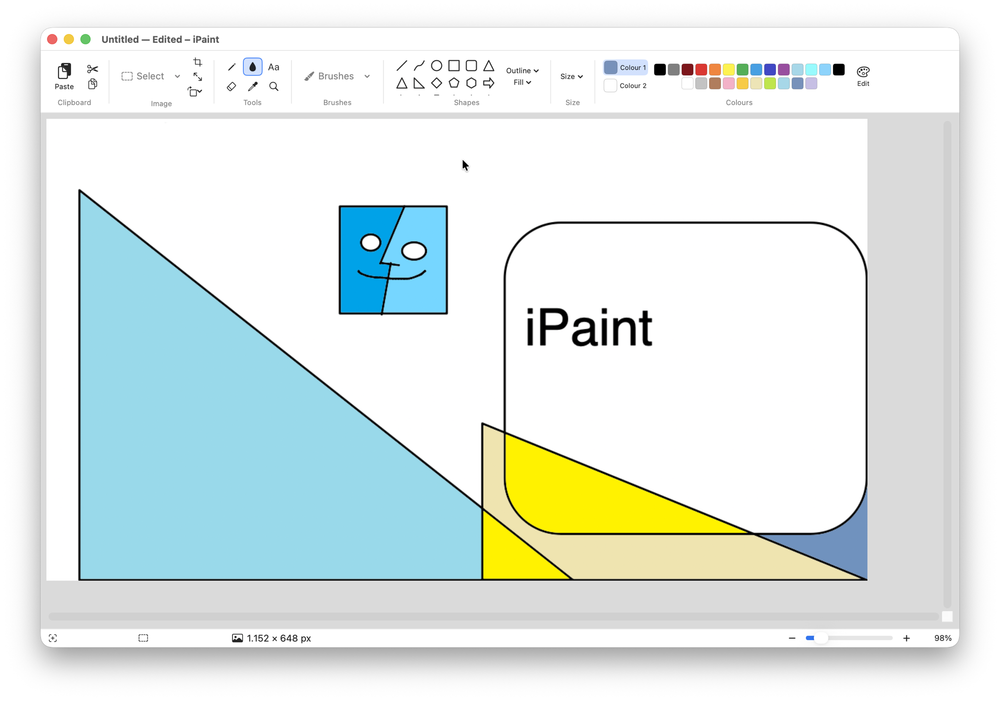

# iPaint

A native macOS recreation of Windows 11 Paint, written in Swift (AppKit + SwiftUI).

It started as a Christmas gift for a teacher who used Paint every day for years,
switched to a Mac, and found nothing that worked the way she expected. If you
moved from Windows and miss the real thing, this is for you too.



The aim is Paint's *behaviour*, not a pixel-copy of its chrome: Colour 2 on the
right mouse button, Shift to constrain a shape, the same tools under the same
names, on a window that looks at home on macOS.

Website: **https://g4bcloud.github.io/iPaint/** — it lives in `docs/` and is
served by GitHub Pages (enable under **Settings → Pages → Source: main branch,
/docs folder**).

## Requirements

- macOS 14 (Sonoma) or later
- Xcode 15+, or just the Command Line Tools (`xcode-select --install`)

No third-party dependencies, and there are no plans to add any — `git clone` and
build is the whole setup.

## Build and run

```bash
git clone https://github.com/g4bcloud/iPaint.git
cd iPaint
./scripts/build-app.sh      # compiles and produces ./iPaint.app
open iPaint.app             # run it
```

That takes about 12 seconds from cold. `build-app.sh` builds a release binary,
renders the icon, assembles the bundle and ad-hoc signs it.

To install it properly, so it shows up in Launchpad and Spotlight:

```bash
cp -R iPaint.app /Applications/
```

**First launch:** macOS will say the app is from an unidentified developer,
because the bundle is ad-hoc signed rather than notarised. Right-click it in
Finder and choose **Open**, then confirm. You only do this once. (If you are
setting this up for someone non-technical, do that step for them.)

### Releases

Merging to `main` runs both check suites first and only builds and publishes a
signed `.app` if they all pass —
see [`.github/workflows/release.yml`](.github/workflows/release.yml). Versions
are `1.0.<build number>`, so they only ever climb. Grab the newest zip from the
[Releases page](https://github.com/g4bcloud/iPaint/releases) if you would rather
not build it yourself. Doc-only changes do not cut a release.

Pull requests are built and checked by
[`ci.yml`](.github/workflows/ci.yml), which also attaches the built app so a
reviewer can try the change without compiling it.

### While developing

```bash
swift build                 # fast compile check, no bundle
./scripts/run-tests.sh      # both check suites
```

`swift run` will technically launch it, but the app wants a bundle for its icon,
menu bar and document types — use `./scripts/build-app.sh` to test anything
real.

## Contributing

Please read **[AGENTS.md](AGENTS.md)** first. It covers the architecture, the
design guidelines, and eight invariants that are each a bug already fixed here —
things like "a `@Published` sink must never read the property it observes" and
Core Graphics' two conflicting vertical conventions. They are easy to
reintroduce and most of them fail silently.

It is written to be equally useful to a human contributor or a coding agent.
`CLAUDE.md` just points at it.

Known gaps and good first issues are listed at the end of that file; Layers is
the biggest one.

## What's included

**Tools** — Pencil, Fill with colour (flood fill), Text, Eraser, Colour picker
(eyedropper), Magnifier, rectangular Select, free-form Select.

**Brushes** (9, matching Paint's gallery) — Brush, Calligraphy pen, Calligraphy
brush, Airbrush, Oil brush, Crayon, Marker, Natural pencil, Watercolour.

**Shapes** (23) — Line, Curve, Oval, Rectangle, Rounded rectangle, Polygon,
Triangle, Right-angled triangle, Diamond, Pentagon, Hexagon, four Arrows,
four-/five-/six-point Stars, three Callouts, Heart, Lightning. Each supports
Outline and Fill styles.

**Filling** — Fill with colour blends into anti-aliased edges by coverage, so
the fill meets an outline exactly instead of leaving a pale fringe tracing it.
It will not bleed a tinted border into a neighbouring solid colour, and a 1px
outline still holds it in. Isolated pixels tucked into a sharp vertex can stay
dark; the feather is one pixel deep on purpose, since going deeper risks bleed.

**Layers** — Stack drawings in separate layers, so a label can be moved or
hidden without disturbing the diagram under it. Add, duplicate, delete,
reorder, rename, hide, set per-layer opacity, merge down (⌘E) or flatten
(⇧⌘E). The panel toggles with ⇧⌘L. Drawing, selecting and erasing act on the
active layer only; Fill with colour works out its region from what you can
*see* and paints onto the active layer. Saving flattens, since none of the
supported formats carry layers.

**Canvas size** — Click the picture size in the status bar for presets: Default,
HD 1080p, 2K QHD, 4K UHD, A4 and Letter in both orientations at 150 dpi, and two
squares. Picking one keeps the existing picture at its original scale anchored to
the top-left rather than stretching it, and ⌘Z undoes it. "Custom size…" opens
the Resize and skew dialog for anything else.

**Text** — Click the canvas to get a box with a dashed border. Type in the
middle; drag the **border** to move it. Changing the font, size, bold, italic,
underline or colour updates the text as you type, so you can see it before
committing. The box grows to fit, wraps at its width, and clicking away places
the text. Esc throws it away.

**Image** — Resize and skew (pixels or percentage, aspect lock, stretch
toggle), Crop to selection, Rotate 90°/180°, Flip horizontal/vertical, Invert
colours, Clear canvas.

**Colours** — Paint's exact 20-colour default palette, Colour 1 / Colour 2
slots, up to four custom colours via the system colour picker.

**Hover help** — Every control shows a Paint-style card naming it and
explaining what it does, including the 20 palette colours by name and the Shift
and click hints for shapes. The first card waits 0.6s (Windows itself uses
0.5s); once one is up, moving to another control replaces it after 0.15s. Both
delays are constants at the top of `Tooltip.swift` — raise `delay` if the cards
still feel eager, or `reshowDelay` if sweeping the ribbon feels busy. Cards get
out of the way of an open dropdown and are dismissed by a click.

**Zooming** — Pinch on the trackpad to zoom smoothly, anchored so the spot
under your fingers stays put. Two-finger double tap toggles between 100% and
fitting the window, ⌘-scroll zooms, and the +/− buttons and ⌘+/⌘− step through
fixed levels. Pinch is continuous, so it can land anywhere between 12.5% and
800%; the stepped controls then snap back to the nearest level.

**Canvas** — Zoom 12.5%–800%, gridlines, marching-ants selection, floating
selections you can drag or nudge with the arrow keys, transparent selection,
clipboard cut/copy/paste (paste grows the canvas like Paint does), and a
60-step undo history.

**Files** — Open and save PNG, JPEG, BMP, GIF and TIFF.

## Mouse and keyboard

Colour 1 draws with the left button, Colour 2 with the **right** button, exactly
as in Paint. Hold <kbd>Shift</kbd> to constrain shapes to a square/circle or
snap lines to 45°. The Curve tool takes three clicks (drag the line, then set
each control point); the Polygon tool takes repeated clicks, finished with a
double-click or <kbd>Return</kbd>.

Standard macOS shortcuts apply (<kbd>⌘Z</kbd> undo, <kbd>⌘Y</kbd> redo,
<kbd>⌘S</kbd> save, <kbd>⌘A</kbd> select all, <kbd>⌘0</kbd> actual size,
<kbd>⌘G</kbd> gridlines). Where Paint uses a Windows convention, the Mac
equivalent is used instead, so muscle memory from the rest of macOS still works.

## Tests

```bash
./scripts/run-tests.sh
```

Two suites of plain executables, no XCTest, so they run anywhere a toolchain
does. The engine suite checks pixels: flood-fill containment, undo/redo,
rotation and flip orientation, crop, both resize modes, skew, save/load
round-trips, all 23 shape paths, zoom stepping, canvas presets, and tooltip
behaviour. The canvas suite drives a real `NSScrollView` to check the view
resizes in step with the zoom and that pinching holds the anchor pixel under the
pointer.

See [AGENTS.md](AGENTS.md) for the file-by-file layout and the testing
conventions worth knowing before adding a check.

## Known gaps

Text is rasterised once placed, so it cannot be re-edited afterwards (it can be
moved and restyled freely up until then). Resizable selections and single-key
tool shortcuts are absent. Layer files are not saved — layers live for the
editing session only, because PNG and friends cannot store them. Flood fill is the slowest operation in
the app (~8ms at the default canvas size, ~51ms at 4K).

Pixel-identical fidelity to Paint's Fluent chrome isn't attempted — the ribbon
uses native macOS controls deliberately. Paint's AI features (Cocreator,
Generative erase, Remove background) are not planned.

## Licence

Not yet chosen — add one before publishing. iPaint is an independent
reimplementation and is not affiliated with or endorsed by Microsoft.
